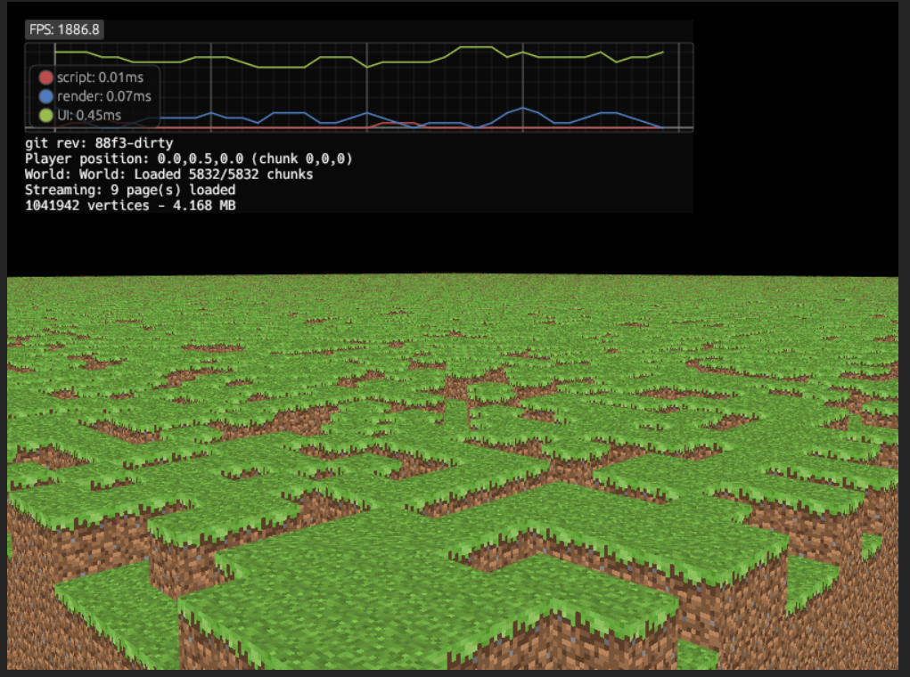

## What is this?

trying to make a little game in Rust WASM + WebGL2.

uses vite + Typescript (for some reason all rust WASM doc uses webpack but I am stubborn I wanted Vite)

Game (in the backend directory): Rust compiled to WASM

uses glam for maths and web-sys for JS bindings. I still have gloo in my dependencies but not sure I'll end up using it.

Github page: <https://vizigr0u.github.io/rust-wasm-gl/>

As of 2024-03-29:

- basic game engine structure (not final): Game, GameObject, Mesh, Shader, Renderer, Time, Camera, InputSystem.
- voxel world with "streaming" and "generation".



For now as a proof of concept, I'm using textures extracted from a very famous game. I will change these very soon, please don't sue me.

I don't want to bother with JS/WASM interaction too much so everything is handled on the WASM (Rust) side.
I might experiment at some point to check whether request-animation-frame can be better off left on the JS side and call the loop on the WASM side.

Web page : just a canvas, the game engine for now just shows img containing textures as they get loaded, for debug purposes.

## Getting Started

```bash
git clone https://github.com/vizigr0u/rust-wasm-gl
pnpm install

# compile Rust into WASM
pnpm wasm

# start local web server
pnpm dev

# or build
pnpm build
```


## Testing

```bash
# run the logic tests (voxel-core)
pnpm test

# snapshot tests use insta; review and accept changed snapshots
cargo install cargo-insta   # once
cargo insta test -p voxel-core --review
```
